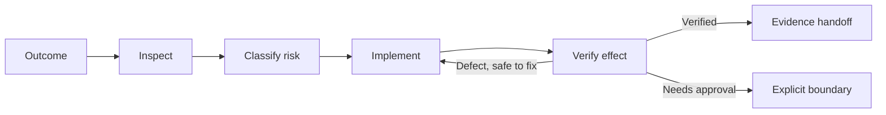

# AstraBooster

**Outcome-first engineering for AI coding agents.**

AstraBooster is a lightweight, model-agnostic Agent Skill that helps coding agents deliver observable results rather than stop at plausible code, a green build, or a reassuring UI notification.

It gives an agent a repeatable method to define the real user outcome, choose verification proportional to risk, trace the result to its destination, correct defects within scope, and hand off evidence. No daemon, API key, paid service, or additional framework is required.

> An independent, community-developed skill. Not affiliated with or endorsed by OpenAI, Anthropic, Codex, Claude, or Astra. It does not unlock models or change reasoning-effort settings.

[Русский](README.ru.md) · [Strategy](docs/STRATEGY.md) · [Examples](#examples) · [Security](SECURITY.md) · [MIT License](LICENSE)

## The problem

A feature can build successfully while failing its actual purpose:

- The contact form says **“Thanks”** but the message never arrives.
- The API responds **200 OK** but an asynchronous job or database write fails.
- The dashboard looks finished but its main action does nothing.
- The agent runs expensive end-to-end suites for a minor copy edit—or skips essential checks for a payment flow.

AstraBooster treats **verified outcomes** as the goal.

## The method



**Five evidence levels:** changed → build-checked → behavior-checked → flow-checked → effect-confirmed. An agent must report the highest level it actually observed, not the level it hopes it achieved.

| Principle | What it does |
| --- | --- |
| **Evidence before claims** | Traces a user action through to persisted data, a test inbox, a job result, or another receiving system. |
| **Risk-proportional checks** | Uses a focused check for a small edit and deeper integration checks for auth, money, data or concurrency. |
| **Bounded self-correction** | Fixes concrete failures and reruns affected checks without endless blind retries. |
| **Safe autonomy** | Respects the repo policy, tool permissions and explicit approval gates for production or external effects. |
| **Independent review when useful** | Integrates with an existing second agent only when the change warrants the expense. |
| **Compact context** | Loads specialist references only when relevant; no duplicate global rules or heavyweight orchestration. |
| **UI acceptance** | Reviews a rendered screen, its primary action, mobile layouts and meaningful failure states. |

### Product strategy

AstraBooster is designed as **a portable quality layer, not another coding agent**. It works with existing tools, tests, repositories, project instructions and task coordinators. The core stays universal; private infrastructure policies belong in each project, not in the public skill.

Read the [product strategy and architecture](docs/STRATEGY.md) for positioning, workflow, use cases, differentiation and extension principles. [Стратегия по-русски](docs/STRATEGY.ru.md).

## Installation

Copy the entire `astra-booster/` directory into a supported skill location:

| Host | Project scope | User scope |
| --- | --- | --- |
| Codex | `.agents/skills/astra-booster/` | `~/.agents/skills/astra-booster/` |
| Claude Code | `.claude/skills/astra-booster/` | `~/.claude/skills/astra-booster/` |

The installed folder must contain `SKILL.md`, `references/`, and `agents/`. **Keep existing `AGENTS.md` and `CLAUDE.md` intact.** Optional additions are in [examples](examples/).

Invoke `$astra-booster` in Codex. In supported Claude Code installations use `/astra-booster`, or allow skill discovery from its description. Tool availability and authorizations remain controlled by the host.

## Examples

**Contact form**

```text
$astra-booster Verify the contact form in staging. Submit a uniquely tagged
request and confirm that the same tag reached the permitted test inbox/CRM.
If delivery cannot be observed, say exactly how far verification reached.
```

**API and persistence**

```text
$astra-booster Fix this API integration. Reuse the current architecture,
check a successful flow and one important failure path, read back the stored
record, and report the real evidence.
```

**Product UI**

```text
$astra-booster Complete the dashboard. Open the rendered UI at desktop and
mobile sizes, exercise the main action and fix important usability defects.
```

**Multi-agent change**

```text
$astra-booster Complete this multi-file feature. Respect existing locks
and task ownership; request independent review only for material risk.
Hand off changed files, actual checks and any blockers.
```

## Repository layout

```text
astra-booster/
  SKILL.md                  # Compact execution protocol
  agents/openai.yaml        # Optional UI metadata
  references/               # Read only what the task needs
docs/                       # Product strategy and architecture
examples/                   # Optional project rules, never auto-merged
tests/                      # Structural validator and scenario library
```

## Scope and security

AstraBooster is a skill, **not an access-control boundary**. It cannot grant permissions or verify inaccessible systems. It neither performs production operations automatically nor authorizes payments, migrations, notifications or destructive actions. Those require the applicable host permissions and user approval. The final report must distinguish confirmed behavior from partial verification.

See [Security](SECURITY.md), [evaluation guidance](astra-booster/references/evaluation.md), and [contributing](CONTRIBUTING.md).

## Licensing and provenance

The public package contains an independent implementation of general software-delivery and acceptance-testing principles. See [NOTICE](NOTICE.md). Original materials in this repository are offered under the [MIT License](LICENSE).
