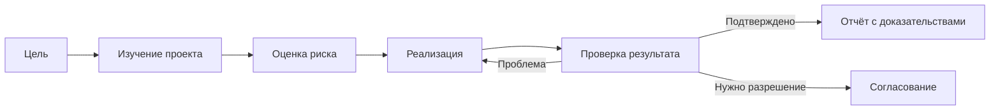

# AstraBooster

**Инженерный скилл для AI-агентов, ориентированный на подтверждённый результат.**

AstraBooster помогает Claude Code, Codex и другим совместимым агентам не останавливаться на красивом коде, успешной сборке или сообщении «Спасибо». Цель — сделать именно то, что требуется пользователю, проверить результат доступными инструментами и честно передать доказательства.

Это лёгкий переносимый Agent Skill: без дополнительных серверов, обязательного MCP, новых API-ключей или фонового демона.

> Независимый проект сообщества. Не связан с OpenAI, Anthropic или Astra и не является средством разблокировки моделей либо изменения reasoning effort.

[English](README.md) · [Стратегия и архитектура](docs/STRATEGY.ru.md) · [Установка](#установка) · [Примеры](#примеры) · [Безопасность](SECURITY.md) · [MIT](LICENSE)

## Зачем он нужен

Код может собираться, а продукт — не работать:

- Форма успешно отправилась на экране, но заявка не дошла до CRM.
- API вернул `200 OK`, но запись в БД отсутствует.
- Интерфейс визуально готов, однако основное действие не работает.
- Агент завершил задачу без проверки главного сценария.
- На незначительные изменения тратятся лишние инструменты, тесты и контекст.

**AstraBooster вводит правило: результат должен подтверждаться наблюдением, а не уверенностью агента.**

## Как он работает



**Пять уровней подтверждения:**

1. Изменён код или подготовлен артефакт.
2. Пройдены сборка или статические проверки.
3. Сработал целевой тест.
4. Пройден настоящий пользовательский/API-сценарий.
5. Конечный эффект найден у получателя или в хранилище.

Агент сообщает только фактически подтверждённый уровень.

| Возможность | Польза |
| --- | --- |
| Конечный результат вместо формальности | Проверка именно того, что нужно пользователю |
| Проверки по риску | Быстрее мелкие задачи, глубже критичные |
| Поиск настоящей причины | Исправление дефектов и повторная целевая проверка |
| Безопасная автономность | Production, платежи, сообщения и удаление за границей разрешений |
| Независимое ревью | Второй агент подключается только при необходимости |
| Экономия контекста | Справочные инструкции читаются по ситуации |
| Работа нескольких агентов | Короткая передача задач, файлов, доказательств и блокеров |
| Визуальная приёмка | Просмотр реального UI, мобильной версии и ошибок |

Подробности в документе [Стратегия AstraBooster](docs/STRATEGY.ru.md).

## Установка

Копируй всю папку `astra-booster/` в каталог скиллов нужной среды:

| Среда | В проект | Для пользователя |
| --- | --- | --- |
| Codex | `.agents/skills/astra-booster/` | `~/.agents/skills/astra-booster/` |
| Claude Code | `.claude/skills/astra-booster/` | `~/.claude/skills/astra-booster/` |

Убедись, что перенесены `SKILL.md`, `references/` и `agents/`. Существующие `AGENTS.md` и `CLAUDE.md` **не перезаписывать**. Необязательные фрагменты правил находятся в [examples/](examples/).

Для Codex: `$astra-booster`. В Claude Code: `/astra-booster`, если поддерживается установленной версией, либо автоматическое обнаружение.

## Рекомендуемый уровень мышления Astra

Для сложных инженерных задач с GPT-6.2 Astra, где качество важнее скорости, AstraBooster рекомендует **Extra High (`xhigh`)**. Для особо сложных задач выбирай **Maximum (`max`)**, если этот режим доступен в выбранной модели и среде и соответствует бюджету.

| Задача | Reasoning effort Astra |
| --- | --- |
| Сложная разработка, отладка, архитектура и сквозная приёмка | `xhigh` |
| Особенно сложные или высокорисковые изменения и независимое ревью | `max`, если доступен и оправдан |

Перед началом выбери модель и уровень мышления в настройках агента, затем вызови `$astra-booster`. Это рекомендация для приоритета качества, а не обязательное требование: для простых задач допустим меньший уровень, для других моделей — собственные поддерживаемые режимы. Высокий reasoning может увеличить время и расход токенов. Скилл сам не меняет настройки модели.

Официальная документация: [GPT-6.2 Astra](https://developers.openai.com/api/docs/models/gpt-6.2-astra) · [Reasoning effort](https://developers.openai.com/api/docs/guides/reasoning).

## Примеры

**Проверка формы**

```text
$astra-booster Проверь форму на staging. Отправь заявку с уникальной
меткой, затем найди эту же метку в разрешённом тестовом ящике или CRM.
Не отправляй реальные уведомления. Покажи фактическое доказательство.
```

**API и БД**

```text
$astra-booster Исправь API-интеграцию. Изучи текущую архитектуру,
проверь успешный запрос, отказ авторизации и чтение сохранённой записи.
Не называй доставленным то, что не проверил у получателя.
```

**Интерфейс**

```text
$astra-booster Заверши экран дашборда. Открой готовую страницу
на десктопе и мобильной ширине, проверь основное действие и ошибку.
Исправь найденные существенные проблемы.
```

**Работа нескольких агентов**

```text
$astra-booster Доведи многофайловую задачу до результата, сохрани
действующие блокировки и ограничения. Передай следующему агенту
изменённые файлы, выполненные проверки и точные блокеры.
```

## Структура

```text
astra-booster/
  SKILL.md               Универсальный протокол
  agents/openai.yaml     Метаданные интерфейса
  references/            Проверки по типу задачи
docs/                    Стратегия и архитектура
examples/                Необязательные правила проекта
tests/                   Валидатор и набор сценариев
```

## Границы

Скилл не выдаёт прав доступа и не заменяет тестовую среду. Проверки production, реальные платежи, миграции, удаление данных, сетевые изменения и внешние уведомления выполняются только с соответствующими разрешениями. Если конечный эффект недоступен для наблюдения, агент обязан обозначить границу проверки.

[Безопасность](SECURITY.md) · [Методика оценки](astra-booster/references/evaluation.md) · [Участие в разработке](CONTRIBUTING.md)

## Лицензия

Проект распространяется по [MIT](LICENSE). AstraBooster — самостоятельная реализация общих инженерных принципов контроля качества и приёмки. См. [уведомление об источниках и названиях](NOTICE.md).
