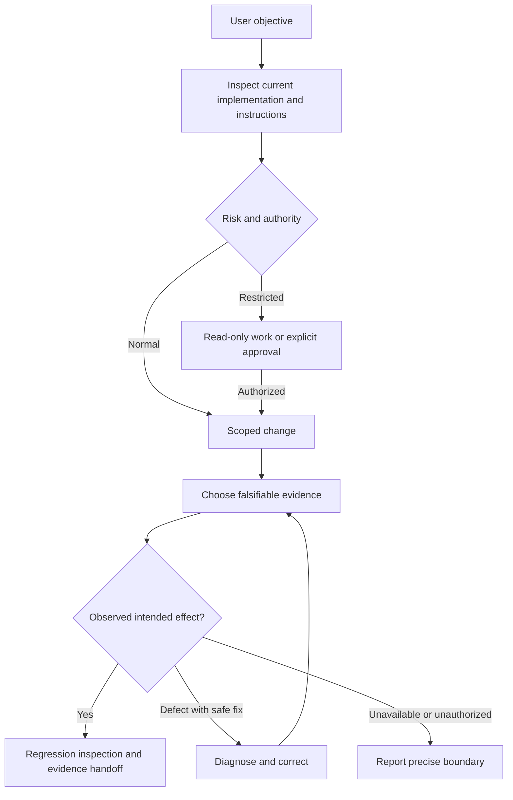

# AstraBooster — product strategy

## Positioning

**A quality and acceptance layer for AI-assisted software development.** Not another autonomous coding agent, not an agent orchestrator, and not a promise of special access to a model. AstraBooster structures how an existing agent turns a request into a result the user can actually observe.

Its central proposition is **observable completion over plausible completion**.

## Why this matters

A coding agent can deliver compelling-looking artifacts that fail the business objective. A build may pass while database writes fail; a UI may show success while downstream delivery never happens; an integration may work only under a mocked dependency. Conversely, treating every change like a large audit imposes unnecessary cost.

The workflow addresses both failure modes: *insufficient verification when correctness matters* and *excessive ceremony when a cheap check suffices*.

## The AstraBooster loop



**Define the outcome before changing the code.** Who does what, what proof should exist, where can it be observed, and what must not happen?

**Inspect the current system.** Reuse existing architecture, configuration, task ownership, tests and protection mechanisms rather than inventing another stack.

**Route by failure impact.** A one-line copy correction requires a focused check. A payment, permissions change or persistence bug requires stronger verification and usually independent review.

**Test the claim, not the implementation story.** Check whether the expected effect can be observed and, where relevant, traced into a receiving system using a unique marker.

**Fix within a bounded budget.** After a real failure, change the hypothesis or approach before retrying. Stop at authorization or access limits.

**Hand off evidence.** A concise final response states the outcome, environment, actual checks and remaining boundary. It does not equate optimistic language with proof.

## Five evidence levels

| Level | Supported claim |
| --- | --- |
| 1. Changed | The relevant artifact or code exists |
| 2. Build-checked | Syntax, lint, typecheck or build executed |
| 3. Behavior-checked | A focused behavioral assertion passed |
| 4. Flow-checked | The permitted multi-component scenario ran |
| 5. Effect-confirmed | The destination or persisted effect was independently observed |

A toast or 200 response can coexist with a failure at levels 4–5. An agent should report the **highest observed** level, not the highest desired level.

## Distinctive product choices

| Conventional pattern | AstraBooster approach |
| --- | --- |
| Generic prompt: “be thorough” | Concrete outcome, risk and evidence contract |
| Build as definition of done | Separate build, behavioral, journey and downstream proof |
| Universal exhaustive testing | Risk-proportionate depth |
| Unlimited self-correction | Bounded retries tied to new evidence |
| Mandatory multi-agent workflow | Existing reviewer only if justified |
| Global mega-prompt | Small core with task-specific references |
| Infrastructure-specific instructions | Portable skill with private per-project overlays |
| Confident summary | Report aligned to observed evidence |

These are architecture decisions; they do not imply a measured improvement percentage.

## Target audiences

**Solo founders / vibe coding:** the agent owns the implementation and appropriate verification instead of offloading obvious checks to the user.

**Small engineering teams:** reviewers get objective evidence and clean change scope.

**Multi-agent systems:** handoff preserves task ownership, confirmed decisions, changed files and remaining tests.

**SaaS, API and automation:** authentication, storage, queues, webhook processing and downstream delivery receive the checks warranted by their risk.

**Product/UI teams:** rendered appearance, mobile layout, primary action and error states receive actual acceptance attention.

**Infrastructure operators:** safe discovery and approval gates prevent a quality workflow from becoming an unauthorized production action.

## Minimal architecture

```text
User intent
  └── Existing agent and its permitted tools
      ├── Repository policy: AGENTS.md / CLAUDE.md
      ├── AstraBooster: shared acceptance protocol
      ├── Specialized skills: API, UI, testing, security
      └── Project-specific infrastructure, CI, task queue and KB
```

### Universal core + local policies

The public `astra-booster/SKILL.md` stays portable. It never embeds private IPs, production topology, credentials, environment-specific resource limits or organizational instructions.

Each installation inherits its own repository instructions and permissions. The project owner may add optional local policy or a private reference without changing the upstream public methodology.

### Context efficiency

A skill should be invoked only when its value outweighs the overhead. Metadata is compact; `SKILL.md` indexes each reference with its trigger, so an agent opens only the one it needs. Default retry limits bound repair loops, and the validator caps the size of `SKILL.md`. Routine changes should not trigger expensive renderers, parallel agents or full regression suites.

## Potential efficiency gains

AstraBooster is designed to reduce the **total cost of an accepted task**, rather than merely minimize the cost of a single model call. The following ranges are planning targets for complex, multi-step work; actual outcomes depend on task type, existing engineering practices, model, reasoning effort and tool access.

| Metric | Potential improvement |
| --- | ---: |
| Less manual intervention | 30–50% |
| Fewer correction cycles | 20–40% |
| Fewer missed defects | 20–40% |
| Higher overall productivity | 15–30% |
| Shorter time to accepted result | 10–25% |
| Lower total token usage per accepted task | 5–20% |

These are illustrative target ranges, not measured performance statistics. Simple edits may see little benefit or incur additional overhead. Higher reasoning effort and independent review can increase initial cost; the economic value comes from avoiding unnecessary rework across the entire delivery cycle.

## Efficiency by task type

Illustrative productivity targets, expressed as potential improvement in the number of accepted tasks per unit of effort:

| Task | Target improvement |
| --- | ---: |
| Simple edits | −5% to +5% |
| Feature development | 10–25% |
| Debugging | 15–30% |
| APIs and integrations | 15–35% |
| Frontend and UX | 10–25% |
| DevOps and infrastructure | 10–30% |
| Multi-agent collaboration | 15–35% |
| Complex multi-step tasks | 20–40% |

### Illustrative economics

Assume a workload costs $1,000 per month and consumes 200 agent-hours. A 15% reduction in total cost would save $150 per month ($1,800 per year); a separate 20% reduction in execution time would free 40 agent-hours per month (480 per year). These are scenario calculations under chosen assumptions, not observed results.

Compare against the same model, reasoning level and task mix. Prioritize acceptance rate, defects, manual interventions, end-to-end latency and total cost per accepted task. See the [evaluation protocol](../astra-booster/references/evaluation.md).

## Use cases

**Contact form:** submit a tagged request to staging; follow it through API processing and identify the same tag at the permitted CRM or inbox. A success message is not the acceptance criterion.

**Asynchronous API:** submit a job, track its correlation ID, verify worker completion or independent read-back, and exercise a failure path.

**UI/dashboard:** inspect the actual rendered page in primary viewports; activate the main control; check a meaningful empty or failed state.

**Sensitive infrastructure:** inspect read-only, identify exact changes and rollback, request permission before production mutations.

## Distribution and evolution

AstraBooster is installed as a plain Agent Skill folder. It uses existing tools and requires no daemon, account, hosted service or mandatory external dependency.

Extensions should remain purposeful: improve a specific observable failure mode, add deterministic acceptance fixtures, sharpen host compatibility or clarify policy precedence. Avoid growing the main prompt without a clear payoff.

The purpose is not to make an agent claim it is smarter. The purpose is to make the work **easier to accept, safer to execute and simpler to verify**.
