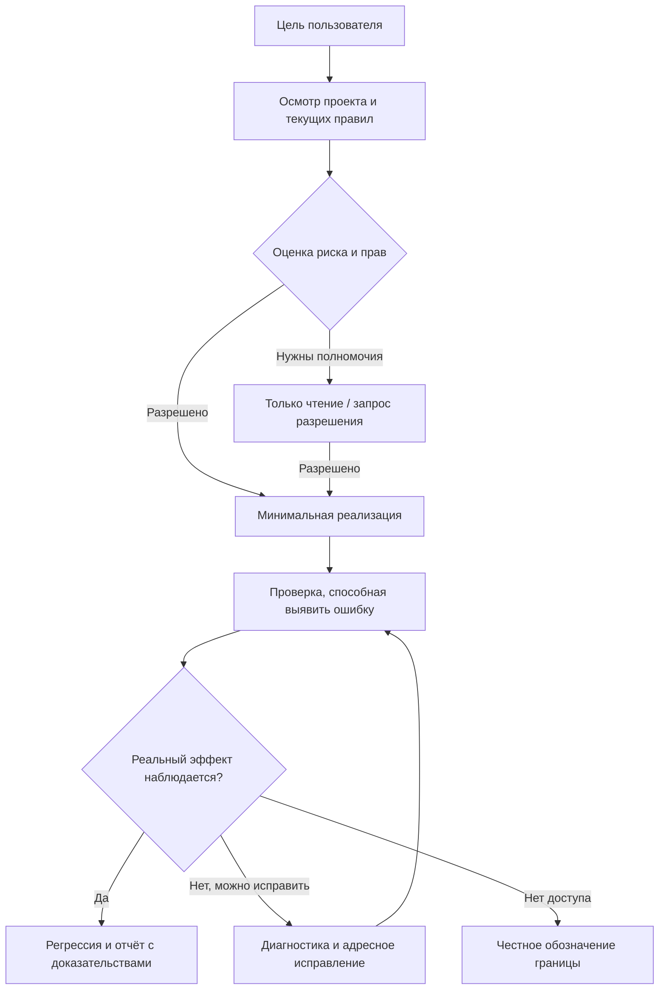

# AstraBooster — стратегия продукта и архитектура

## Позиционирование

**AstraBooster — инженерный слой качества для AI-разработки.** Это не ещё один программирующий агент и не оркестратор. Это переносимая методология, которая помогает уже существующему Codex, Claude Code или другому агенту доводить порученную задачу до наблюдаемого результата.

Главный принцип: **реально выполненная задача важнее правдоподобной демонстрации**.

## Какую проблему решаем

Агент может сдать красивую страницу, пройти сборку, показать сообщение об успехе и всё же не выполнить цель. Заявка не дошла до CRM, асинхронная задача не завершилась, результат не записан в базу, кнопка не работает. Другой перекос — тратить дорогостоящие проверки и десятки тысяч токенов на правку нескольких строк.

AstraBooster направлен на две вещи одновременно: **обязательная проверка существенного результата** и **отсутствие лишних действий там, где достаточно простого контроля**.

## Протокол работы



1. **Сформулировать результат.** Кто выполняет действие, где должен появиться эффект и чем он подтверждается.
2. **Проверить текущую реализацию.** Прочитать релевантные файлы, инструкции, конфигурацию и статус работы других агентов.
3. **Оценить риск.** Для небольшой правки — дешёвый целевой тест; для авторизации, денег, БД и интеграций — глубокая проверка; для production — обязательные ограничения полномочий.
4. **Внести минимальное изменение.** Не перестраивать систему, если локальное исправление решает задачу.
5. **Проверить конечный эффект.** По возможности пройти весь пользовательский путь, а не только проверить компиляцию.
6. **Исправить причину ошибки.** Повторять проверку после значимого изменения, а не бесконечно повторять одну команду.
7. **Передать результат.** Сообщить наблюдаемое доказательство и конкретные ограничения без вымышленных успешных проверок.

## Пять уровней доказательств

| Уровень | Что реально доказано |
| --- | --- |
| 1. Изменено | Файл/код/артефакт существует |
| 2. Собирается | Пройдена релевантная техническая проверка |
| 3. Проверено поведение | Выполнен целевой тест |
| 4. Работает сценарий | Пройден путь через нужные компоненты |
| 5. Эффект подтверждён | Получатель, запись или конечное состояние проверены независимо |

Успешная кнопка или `200 OK` не означают успешную доставку. Агент сообщает **максимальный реально подтверждённый уровень**, не завышая его.

## Почему это сильный продукт

| Обычная проблема | Подход AstraBooster |
| --- | --- |
| Агент останавливается после сборки | Сопоставление результата с целью пользователя |
| Имитация успеха через экран или мок | Сквозная проверка с уникальной меткой |
| Одинаково тяжёлые проверки для всех задач | Глубина зависит от последствий ошибки |
| Бесконечные повторные попытки | Предел затрат и необходимость новой гипотезы |
| Второй агент вызывается всегда | Ревью только по риску и реальной необходимости |
| Промпт перегружен | Короткое ядро и справочники по запросу |
| При смене агента теряется контекст | Передача файлов, проверок, решения и блокера |
| Уверенный отчёт без доказательств | Строгое соответствие заявлений наблюдениям |

Это конструктивные преимущества методологии, без обещаний произвольного процента ускорения.

## Основные пользователи

**Вайбкодеры и независимые основатели продуктов.** Не нужно отдельно напоминать агенту проверить очевидное и довести порученный процесс до завершения.

**Команды разработчиков.** Критерии приёмки, минимальные правки и предметное ревью.

**Системы с несколькими AI-агентами.** Уважение очередей, блокировок, владельцев задач и передача контекста.

**SaaS, Telegram-боты, API и автоматизации.** Проверки записи в БД, очередей, интеграций, прав доступа и конечного получения сообщения.

**Frontend и дизайн.** Реальная визуальная приёмка, главный сценарий, мобильная ширина, ошибочные состояния.

**DevOps.** Разделение чтения, безопасных изменений и опасных операций, которые требуют явного разрешения.

## Архитектура: универсальное ядро и локальная политика

```text
Задача пользователя
  └── Существующий агент и доступные ему инструменты
      ├── AGENTS.md / CLAUDE.md — правила текущего проекта
      ├── AstraBooster — универсальный протокол качества
      ├── Специальные скиллы — тесты, UI, API, безопасность
      └── Существующие Git, CI, staging, БД, очередь, KB
```

### Почему не два независимых скилла

Публичное ядро остаётся переносимым и не содержит частных IP, инфраструктурных секретов, конфигураций, бюджетов или имен внутренних сервисов. Для конкретного VPS или компании применяется отдельная локальная политика, совместимая с текущим оркестратором. Не нужно поддерживать разные копии одинаковой методологии.

### Почему меньше контекста

Скилл включается для задач, где действительно нужен контроль процесса. Основной `SKILL.md` короткий. Отдельные справочники читаются только при необходимости. Он не требует запускать браузер, второй агент, тяжёлый рендер или полный набор тестов для каждой мелочи.

## Три показательных сценария

**Форма обратной связи.** Агент отправляет заявку с уникальной меткой на тестовом стенде, находит эту метку в разрешённом ящике или CRM и только после этого подтверждает доставку.

**API и база данных.** Агент проверяет фактическую запись или чтение данных и существенный сценарий отказа, не ограничиваясь HTTP-ответом.

**Работа на сервере.** Агент начинает с изучения конфигурации и безопасной диагностики. Перезапуск production, миграция или изменение SSH не выполняются без нужного разрешения.

## Стратегия развития и распространения

- **Простой вход:** установить одну папку скилла в Codex или Claude Code.
- **Независимость:** никакого обязательного MCP, SaaS или отдельного сервера.
- **Модульность:** новые специализированные правила не раздувают базовый промпт.
- **Открытая методика:** примеры, библиотека сценариев и воспроизводимая оценка.
- **Безопасные границы:** права остаются у пользователя и среды исполнения.

AstraBooster не обещает, что модель «разблокировалась» или стала интеллектуально сильнее. Его назначение — **сделать работу агента более проверяемой, управляемой и пригодной к использованию**.
